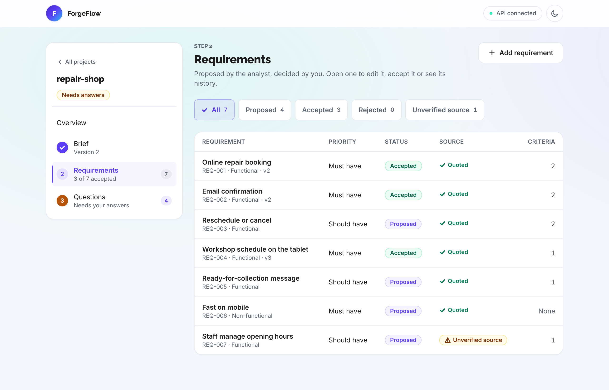
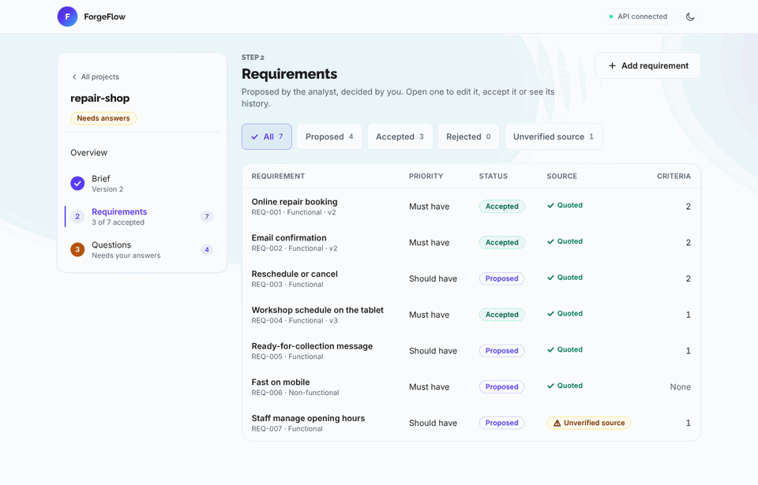
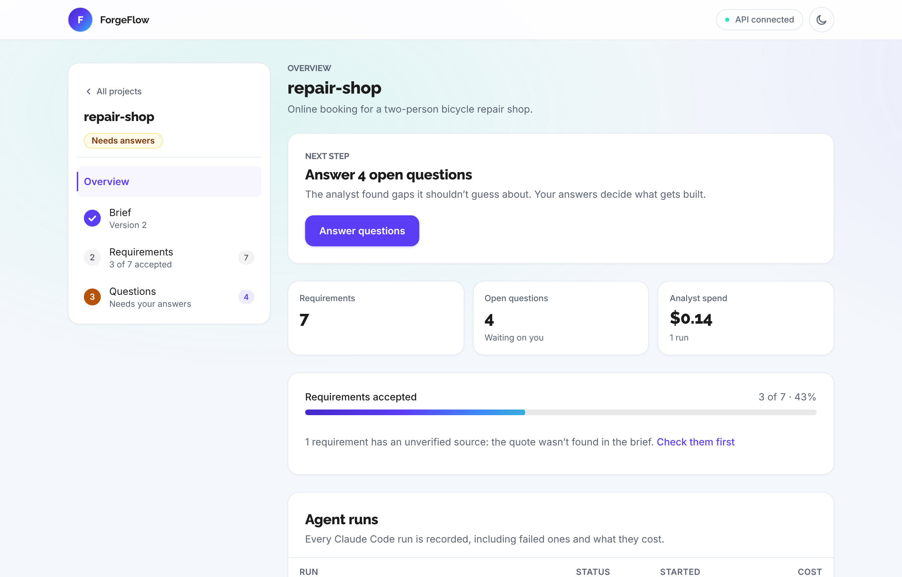
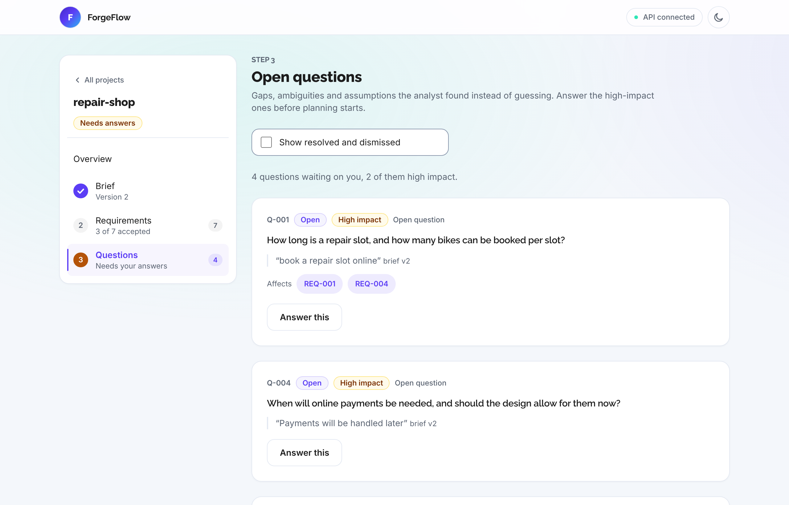
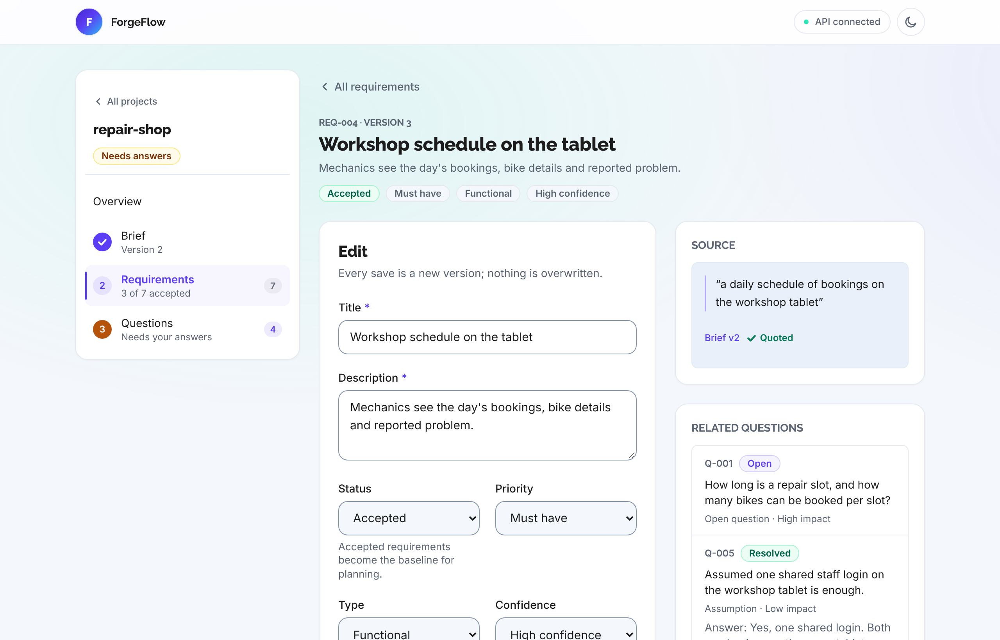
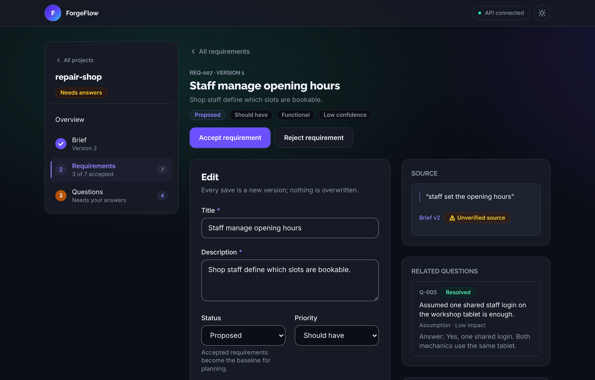

# ForgeFlow

[](https://github.com/sxhumr/ai-agent-orchestrator/actions/workflows/ci.yml)

A local-first orchestrator that takes a project from a business brief to approved requirements, then a plan, code and verification, with Claude Code CLI as the coding runtime. Today it covers the first stretch: a brief goes in, and reviewable, versioned requirements come out, each one traced to the sentence it came from.



## Features

- **Brief to requirements.** Claude Code reads the business brief and proposes requirements with testable acceptance criteria, plus the open questions, ambiguities and assumptions it found instead of guessing.
- **Traceable to the brief.** Every requirement carries a quote from the brief, and ForgeFlow checks it against the text itself. A quote it can't find is flagged as an unverified source, so you know which ones to check first.
- **Nothing is overwritten.** Each edit, accept or reject saves a new version with a note on why it changed. Each brief edit is a new brief version, and requirements keep pointing at the version they came from.
- **You decide.** Nothing is final until you accept it. Answer the analyst's questions, reword a requirement, or add ones the brief missed.
- **Safe by default.**
  - The analyst runs with no tools in an empty folder, so it can't read or change your files.
  - Its output must match a schema and is validated again before anything is saved.
  - The API only listens on this machine, rejects DNS-rebinding requests, and runs one analysis per project at a time.
- **Bounded runs.** Every Claude Code run has a time limit and clean cancellation. Analyst runs have a $1 budget by default and are recorded with their cost, including failed ones; `forgeflow run` takes `--max-budget-usd`.
- **Local and private.** Everything lives in one SQLite file on your machine. There is no account and no hosted service.
- **GUI and CLI.** Every change you can make in the GUI is also a `forgeflow` command.



| Project overview | Open questions |
| --- | --- |
|  |  |
| **Requirement detail** | **Dark mode** |
|  |  |

The screenshots use demo data from [`scripts/seed_demo.py`](scripts/seed_demo.py).

## Status

| Milestone | What it delivers | State |
| --- | --- | --- |
| 1. Claude Code adapter | Run one bounded Claude Code task and record how it ended | Done |
| 2. Structured requirements | Brief to persisted, versioned, traceable requirements and questions | Done |
| GUI | A local web app for everything in Milestone 2 | Done |
| 3. Plan and approval | Architecture proposal, task graph, explicit approval gate | Next |
| 4. Implementation and verification | One approved task at a time, tests and checks, bounded repair loop | Planned |
| 5. Full GUI workflow | Plan approval, execution and verification views | Planned |
| 6. Change impact | Re-analyse a changed brief and replan only what it affects | Planned |
| Later | Parallel agents in isolated Git worktrees | Planned |

[`forgeflow_project_spec.md`](forgeflow_project_spec.md) has the full specification.

## Install

You need Python 3.12 or later, [uv](https://docs.astral.sh/uv/), Node.js 24, and Claude Code CLI on `PATH` and already signed in. Development used Claude Code 2.1.299.

```bash
(cd backend && uv sync)
(cd frontend && npm ci)
```

Without uv, `pip install -r backend/requirements.txt && pip install -e backend --no-deps` works too.

The repository has two halves: `backend/` is the Python package (CLI, API, adapter, store) and `frontend/` is the Next.js GUI.

## Using it

### GUI

Start the API and the GUI, then open http://localhost:3000:

```bash
(cd backend && uv run forgeflow serve)   # API on http://127.0.0.1:8765
(cd frontend && npm run dev)            # GUI on http://localhost:3000
```

Create a project, paste the brief, and generate requirements. Analysis takes about a minute and a typical brief costs $0.10 to $0.30. Then answer the questions and accept, reword or reject each requirement.

To look around without a paid run, seed the demo project first: `uv run --project backend python scripts/seed_demo.py`.

If port 3000 is taken, run the GUI with `npm run dev -- -p 3100` and allow that origin with `uv run forgeflow serve --gui-origin http://localhost:3100`. The GUI finds the API through `NEXT_PUBLIC_API_URL`, which defaults to `http://127.0.0.1:8765`.

### CLI

Run these from `backend/`, or install the command with `uv tool install ./backend` and drop the `uv run` prefix.

```bash
uv run forgeflow project create shop --root ~/code/shop --description "Repair bookings"
uv run forgeflow brief add shop --file brief.md       # each add is a new brief version
uv run forgeflow requirements generate shop            # Claude Code analyses the latest brief
uv run forgeflow questions resolve shop Q-003 --answer "Owner and two staff"
uv run forgeflow req edit shop REQ-002 --status accepted --note "Q-003 answered"
uv run forgeflow req export shop --out docs/requirements   # requirements.md + requirements.json
```

| Command | What it does |
| --- | --- |
| `project create / list / show` | Create a project for a folder, list projects, show one with its counts and runs |
| `brief add / show` | Add a new brief version from a file (`--file`) or inline (`--text`), show any version |
| `requirements generate` | Analyse the latest brief (refuses once a project has requirements) |
| `req list / show / history` | List requirements (`?src` marks an unverified source), show one with its quote and questions, list every version |
| `req add / edit` | Add your own requirement, or save a new version with a change note |
| `req export` | Write Markdown and JSON copies |
| `questions list / resolve` | List open questions, answer or dismiss one |
| `run` | Run one bounded Claude Code task and print a JSON result ([details](docs/runtime-adapter.md)) |
| `serve` | Start the local API for the GUI |

Data lives in one SQLite file at `$FORGEFLOW_HOME/forgeflow.db`, which defaults to `~/.local/share/forgeflow/forgeflow.db`. Pass `--db PATH` to use another. The schema upgrades itself through numbered migrations.

## How it works

```
┌─ frontend/ (Next.js) ────┐   HTTP, loopback only   ┌─ backend/ (Python) ────────────────────┐
│ projects, brief,         │ ──────────────────────► │ api/      FastAPI, thin layer          │
│ requirements, questions  │                         │ cli.py    the same operations          │
│ TanStack Query           │ ◄────────────────────── │    │                                   │
└──────────────────────────┘                         │    ▼                                   │
                                                     │ analysis/ prompt, schema, quote checks │
                                                     │    │                    │              │
                                                     │    ▼                    ▼              │
                                                     │ runtime/  adapter    store/  SQLite    │
                                                     └────┼───────────────────────────────────┘
                                                          ▼
                                       claude -p --output-format stream-json --tools ""
```

- **The adapter** owns everything specific to Claude Code. It runs `claude -p` headless in its own process group, sends the prompt on stdin, and reads the stream-json events. It decides the outcome from the exit code and the final result event, never from output text. Budget, timeout and cancellation stop the whole process group. [Reference](docs/runtime-adapter.md).
- **The analyst** builds the prompt with the brief marked as data, not instructions, and passes a JSON Schema generated from its Pydantic model. It validates the result again, assigns every key itself (`REQ-001`, `Q-001`, `AC-1`), checks each quote against the brief, and writes everything from one analysis in a single transaction.
- **The store** is one SQLite database with append-only versions for briefs and requirements, and a record of every agent run. Dependencies point one way: (CLI, API) → analysis → (runtime, store) → models.

The reasons behind each decision are in [`docs/decisions/`](docs/decisions/) (ADR 0001 to 0003).

## Quality

- **75 unit tests** run on every change in CI. They cover the adapter (through a scripted fake `claude` binary), the analyst, the store and its migrations, the API and the CLI.
- **Live tests** call the real Claude Code CLI to check the adapter and the analyst end to end. They make three small paid calls (about $0.30 in total), so they only run with `FORGEFLOW_LIVE=1`.
- **Strict typing and linting:** `mypy --strict` and Ruff for Python, TypeScript strict mode and ESLint for the GUI.
- **Accessible GUI:**
  - Labelled fields with linked hints and errors.
  - Text contrast of at least 4.5:1 in light and dark modes, and 3:1 for field borders.
  - 44 px buttons and fields, visible focus rings and a skip link.
  - Status changes announced to screen readers, and reduced motion respected.
  - Nothing is thrown away without asking: discarding a draft or dismissing a question asks first.
- **Verified against the real CLI.** What has and hasn't been checked against Claude Code 2.1.299 is listed in [`docs/runtime-adapter.md`](docs/runtime-adapter.md#verified-behaviour-vs-assumptions).

## Limitations

- **Platform:** POSIX only, because cancellation relies on process groups.
- **Workflow:** the project status moves when requirements are generated but not after. The enforced state machine and the approval of the requirements baseline arrive in Milestone 3.
- **Re-analysis:** `requirements generate` refuses once a project has requirements. Re-analysing a changed brief without losing your edits is Milestone 6.
- **Adapter:**
  - Runs started with `forgeflow run` aren't persisted. Analyst runs are recorded, but without their raw events.
  - The adapter doesn't restrict what allowed tools do inside the workspace. That is left to Claude Code's permission system.
  - The environment, including credentials, is passed through to the CLI.
- **CLI:** `req edit --criterion` replaces all acceptance criteria, so repeat the flag for each one you want to keep.

## Development

Python checks run in `backend/`, GUI checks in `frontend/`.

| Check | Command |
| --- | --- |
| Python lint and formatting | `uv run ruff check . && uv run ruff format --check .` |
| Python types | `uv run mypy src` |
| Unit tests | `uv run pytest tests/unit` |
| Live tests (paid, about $0.30) | `FORGEFLOW_LIVE=1 uv run pytest tests/integration` |
| GUI types, lint, build | `npm run typecheck && npm run lint && npm run build` |
| Screenshots and demo GIF | `scripts/capture-media.sh` (needs `npx playwright install chromium` in `frontend/`) |

## Documentation

| Document | Contents |
| --- | --- |
| [`forgeflow_project_spec.md`](forgeflow_project_spec.md) | The full specification and milestones |
| [`docs/architecture.md`](docs/architecture.md) | Modules, GUI and API design, the adapter boundary |
| [`docs/runtime-adapter.md`](docs/runtime-adapter.md) | `forgeflow run`, the adapter API, invocation, limits, verified CLI behaviour |
| [`docs/decisions/`](docs/decisions/) | Decision records: headless stream-json, the SQLite store, structured analyst output |

## Licence

Apache License 2.0; see [LICENSE](LICENSE). Copyright 2026 Sohum Ramouthar.
